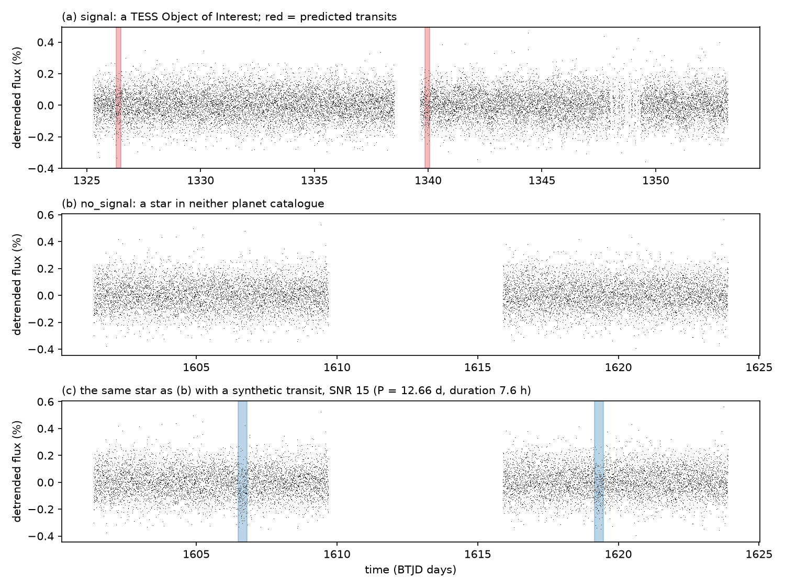
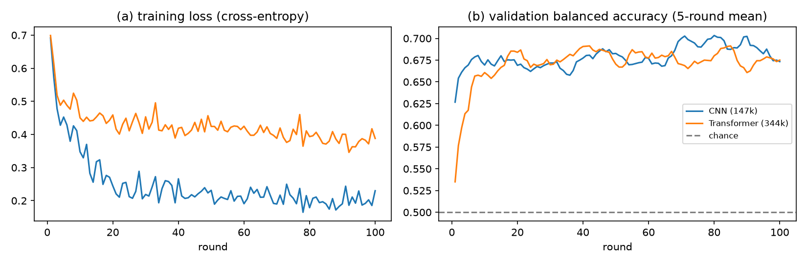
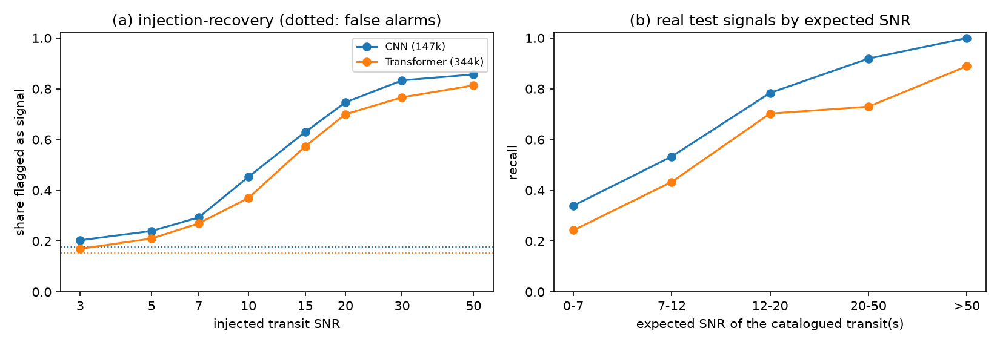
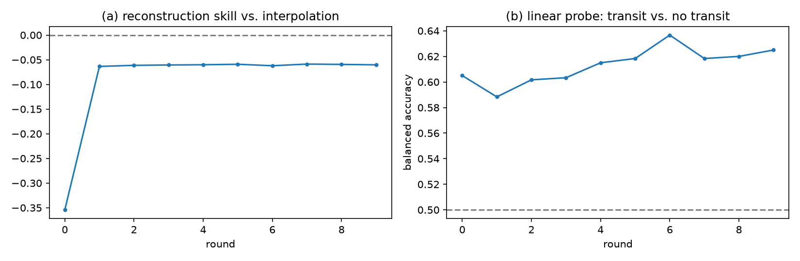

# Whole-Sector Detection of Transit-Like Signals in TESS Light Curves: Streaming Training, Synthetic Transit Augmentation, and Masked-Patch Pre-training

**Author(s):** _to be added_
**Affiliation:** Astro Data Lab
**Status:** working paper, 2 November 2026. Sections 4.1–4.4 report completed
experiments. The foundation-model experiment (Section 4.5) is **in progress**:
its pre-training diagnostics are preliminary, and its outcome is pending. Every
number and figure can be regenerated with `docs/paper/make_figures.py`; see
Section 7.

---

## Abstract

We study whether a neural network can decide, from one complete single-sector
TESS light curve, whether that curve contains a transit-like signal. Our dataset
is the 547,402 two-minute-cadence SPOC light curves of TESS sectors 1–28, about
1.04 TB. We train on whole sectors (≈18,000 readings) without phase folding or
prior knowledge of period, and stream the data through a bounded disk cache. The
labels come from the NASA Exoplanet Archive. A curve is a positive (*signal*) if
its star is a TESS Object of Interest (TOI) *and* a predicted transit of that TOI
falls inside the curve's readings. A curve is a negative (*no_signal*) if its star
appears in neither the TOI list nor the confirmed-planet catalogue. Stars, not
curves, are split 80/10/10 into training, validation and test sets. Half of the
positive training examples are synthetic transits injected into negative curves.

On 600 class-balanced test curves from unseen stars, a 147k-parameter masked 1-D
CNN reaches a balanced accuracy of **0.733** (95% bootstrap CI 0.699–0.768;
chance 0.5; ROC AUC 0.765). A 344k-parameter patch Transformer reaches **0.690**
(0.657–0.723). The CNN's advantage is +0.043 (paired 95% CI +0.002 to +0.081).
Performance is governed by the signal-to-noise ratio (SNR) a transit has within
one sector. The CNN recovers 100% of real test transits with expected SNR > 50
and 92% at SNR 20–50, but only 34% below SNR 7. That region holds 103 of the
300 test positives, mostly TOIs found by combining several sectors. Injected
transits are recovered at 50% near SNR ≈ 11. The false-alarm rate on
uncatalogued stars is 17.7%, so the classifier is not yet a stand-alone detector
at the survey's 1.1% signal prevalence; its precision there would be ≈4%.

We also report a negative result. With four catalogue classes as labels
(confirmed host, candidate host, other TOI, uncatalogued), a CNN reached only
0.389 balanced accuracy (chance 0.25). 46% of confirmed planet hosts in the data
were never flagged as TOIs. The labels described membership in a catalogue, not
the content of the light curve.

Finally, we describe a masked-patch self-supervised pre-training experiment, now
running. A 15M-parameter Transformer reads all 438,704 training-split curves
without labels. It will be compared against an identical model trained from
random weights, under a pre-stated decision rule.

---

## 1. Introduction

The Transiting Exoplanet Survey Satellite (TESS; Ricker et al. 2015) observes
each of its sectors for about 27 days. For pre-selected stars, the Science
Processing Operations Center (SPOC; Jenkins et al. 2016) produces light curves at
two-minute cadence, corrected for instrumental systematics (PDCSAP; Smith et al.
2012; Stumpe et al. 2012). Candidate planets are identified by searching these
curves for periodic dips, typically with matched-filter or box-fitting methods
(Kovács, Zucker & Mazeh 2002), and vetted into the TOI catalogue (Guerrero et
al. 2021).

Most machine-learning work on transits classifies *existing detections*. Models
in the AstroNet family (Shallue & Vanderburg 2018; Yu et al. 2019; Osborn et al.
2020) take a candidate's period and epoch, fold the light curve so all transits
stack into one dip, and decide whether that dip is a planet or a false positive.
That is a different question from the one asked here. Our model receives **no
period, epoch or duration**, only the full sector of readings, and must say
whether anything transit-like is present. It is closer to the detection step
itself, and it is a natural task for whole-sequence neural networks.

Two practical constraints shape this work. First, the archive is large. Sectors
1–28 alone hold 547,402 light curves and about 1 TB of FITS files, more than a
single workstation would keep. Second, labels are scarce. Only about 5,000
training-split curves belong to TOI stars with a transit inside the curve,
against more than 430,000 uncatalogued curves. We address the first with a
streaming training loop that downloads, uses and deletes data in rounds. We
address the second with synthetic transit injection and, in an ongoing
experiment, with self-supervised pre-training on the unlabelled majority. The
pre-training uses the masked-modelling recipe of BERT (Devlin et al. 2019) and
MAE (He et al. 2022), applied to patches of a time series (Nie et al. 2023), as
in the light-curve foundation model Astromer (Donoso-Oliva et al. 2023).

Contributions:

1. A reproducible, bounded-storage pipeline for training on whole TESS sectors,
   with star-level splits and per-round validation on unseen stars (Section 3).
2. A label definition that is verifiable from the data: each positive must
   contain a predicted transit. We also present a documented negative result for
   catalogue-membership labels (Section 4.1).
3. Benchmarks of a CNN and a Transformer, analysed by catalogue disposition, by
   expected per-sector SNR, and by injection-recovery (Sections 4.2–4.4).
4. A pre-registered test of masked-patch pre-training at the scale of the full
   training split (Section 4.5, in progress).

---

## 2. Data

### 2.1 Light curves

We indexed every SPOC two-minute light-curve product (`*_lc.fits`) from MAST for
sectors 1–28: **547,402 curves of 251,324 stars**, totalling 1.04 TB. One curve
is one star observed for one sector. Multiple sectors of the same star are not
combined.

### 2.2 Catalogues

Two tables from the NASA Exoplanet Archive (Akeson et al. 2013) were retrieved
on 31 October 2026. The confirmed-planet table (`pscomppars`) lists 6,451 planets
around 4,551 TIC stars. The TOI table lists 8,151 TOIs on 7,826 stars, with the
dispositions shown below. It also gives each TOI's transit epoch, period,
duration and depth; 8,147 TOIs have an epoch and a duration.

| disposition | meaning | TOIs |
|---|---|---|
| PC | planet candidate | 4,820 |
| FP | false positive (e.g. eclipsing binary) | 1,315 |
| CP | confirmed planet | 815 |
| KP | known planet | 606 |
| APC | ambiguous planet candidate | 490 |
| FA | false alarm (instrumental) | 100 |
| none | — | 5 |

### 2.3 Labels

The target is binary: *does this curve contain a transit-like signal?*

- **signal (1):** the star has at least one TOI with disposition PC, APC, CP, KP
  or FP and a known epoch and duration, **and** at least 10 readings of this
  curve fall within a predicted transit window of that TOI. With epoch
  $T_0$, period $P$ and duration $D$, reading $t$ is in transit when
  $\lvert ((t - T_0 + P/2) \bmod P) - P/2 \rvert < D/2$. When no period is
  given, only the transit at $T_0$ is used. The window check needs the curve's
  timestamps, so it is applied after download. It keeps 4,352 of 4,991 candidate
  training curves (87.2%).
- **no_signal (0):** the star is in neither the TOI table nor the
  confirmed-planet table.
- **excluded:** confirmed planets that are not TOIs, which are often
  non-transiting or found by other methods; FA TOIs; and TOIs without timing.

False positives (FP) are deliberately *positives*. An eclipsing binary
produces a real transit-like signal, and this classifier detects signals. It
does not judge whether a signal is a planet.

### 2.4 Splits

Each star is assigned to a split by the first 32 bits of the MD5 hash of its TIC
ID, modulo 10: eight buckets for training, one for validation and one for test.
All sectors of one star therefore share a split. The assignment is
deterministic and identical for every run and model. It is computed in SQL and
cross-checked against a Python implementation on 5,000 stars.

| | training | validation | test |
|---|---|---|---|
| stars (all curves) | 201,449 | 24,903 | 24,972 |
| no_signal curves | 432,355 | 53,740 | 53,444 |
| signal curves (before window check) | 4,991 | 573 | 648 |

The fraction of labelled curves that are positive is 1.14%. We use this as the
*survey prevalence* in Section 4.2.

### 2.5 Evaluation sets

The **validation set** holds 300 real curves per class from validation stars,
chosen by a fixed hash order. Positives must pass the window check. The **test
set** is built the same way from test stars: 300 signal and 300 no_signal curves.
Neither set contains injected transits. The validation set selects checkpoints.
The test set is used only for final reporting.

---

## 3. Methods

### 3.1 Cleaning and model input

From each FITS file we keep readings with `QUALITY == 0` and finite `TIME` and
`PDCSAP_FLUX`. Readings are sorted by time, and duplicate timestamps are dropped.
The flux is divided by its median. A curve is **unusable** if fewer than 100
readings remain, the median flux is not positive, or the file cannot be read.
Unusable curves are recorded and skipped; 16 have been found so far. Nothing else
is altered: no clipping of dips, no gap filling, no resampling.

*Detrending.* Slow stellar variability is removed by a running median. Its
window is 1 day wide, evaluated every 0.25 days where at least 20 readings fall
in the window, and linearly interpolated to every reading. The detrended flux is
$f/\mathrm{trend} - 1$. A second pass recomputes the median after excluding
readings more than $3\sigma$ below the first trend, so a transit cannot pull the
trend down and erase part of itself.

*Noise.* The per-reading noise is a robust estimate from consecutive
differences,
$\sigma = 1.4826 \cdot \mathrm{MAD}(\Delta f) / \sqrt{2}$,
which is insensitive to slow trends and single outliers.

Each curve becomes a tensor $x \in \mathbb{R}^{4 \times L}$ with $L \approx$
15,000–20,000:

| channel | content | clipped to |
|---|---|---|
| 0 | $(f - 1) \times 100$: brightness change in % | ±100 |
| 1 | detrended flux $/\ \sigma_{\text{detrended}}$ | ±50 |
| 2 | $\log(1 + \Delta t / \mathrm{median}\,\Delta t)$: the gap before each reading | 0–10 |
| 3 | 1 for a real reading, 0 for padding | — |

A minibatch zero-pads curves to its longest member. Channel 3 lets a model
ignore the padding. We check every model to confirm that padding does not
change a prediction.

### 3.2 Synthetic transit injection

To multiply the scarce positives, each training round copies some of its own
no_signal curves and injects a synthetic periodic transit into each copy:

- period $P \sim \text{log-uniform}(0.5, 15)$ days;
- duration $D \sim \mathcal{U}(1, 8)$ hours, capped at $0.15P$;
- epoch at a randomly chosen reading, so at least one transit is visible;
- a trapezoidal shape $s(t) = \mathrm{clip}\big((1 - \lvert\delta t\rvert / (D/2)) / 0.3,\, 0,\, 1\big)$,
  where $\delta t$ is the time from the nearest transit centre. Ingress and
  egress each take 15% of the duration, and the flat bottom spans the middle 70%;
- depth $\delta = \min(\mathrm{SNR} \cdot \sigma / \sqrt{n},\ 0.05)$, where $n$ is
  the number of readings with $s > 0$ and $\mathrm{SNR} \sim \mathcal{U}(8, 40)$;
- injected flux $f' = f\,(1 - \delta\, s(t))$. The draw is retried up to 20 times
  until $n \geq 10$.

Each curve's injection is seeded deterministically from its URI. The model sees
the same star with and without a transit in the same round, so it cannot solve
the task by recognising stars.

### 3.3 Streaming training protocol

Training proceeds in **rounds**. A round of 1,024 curves holds:

- 512 **fresh** no_signal curves that this run has never used, streamed from
  MAST's public S3 copy and deleted after the round;
- 256 **real** signal curves, sampled without replacement from the 4,352
  verified training positives, which stay cached;
- 256 **injected** signal curves, made from half of the round's no_signal curves
  (Section 3.2).

The next round downloads while the current one trains. Each round runs three
passes of minibatch gradient descent: cross-entropy loss, AdamW (Loshchilov &
Hutter 2019), weight decay $10^{-4}$, minibatch 32, gradient-norm clipping at 1.0.
That gives 96 optimiser steps per round. After every round the model is scored
on the validation set. The checkpoint with the highest validation balanced
accuracy is kept as `best.pt`, and every curve used is recorded in PostgreSQL.
Each run lasts 100 rounds, so it sees 51,200 distinct uncatalogued curves. Every
real positive is revisited about six times per run, three passes each time.

### 3.4 Models

**LightCurveCNN** (146,754 parameters for two classes). Four masked
convolutional blocks are applied in sequence. Each consists of a convolution
(kernel 9), a GELU and a max-pool of 4, with channels 3→32→64→64→128. Padding is
re-masked after every block. After the four blocks, one step covers 256 readings,
about 8.5 hours. The blocks are followed by masked mean and max pooling over
time (256 features) and a head of Linear(256→64), GELU, Dropout(0.2) and
Linear(64→2).

**PatchTransformer** (343,618 parameters). The curve is cut into patches of 64
readings, about 2 hours each. Channels 0–2 of each patch are flattened and
embedded linearly to width 64, and a learned position embedding is added. Four
pre-norm Transformer encoder layers follow (Vaswani et al. 2017), with 4 heads,
feed-forward width 256, GELU and dropout 0.1. Patches with no real reading are
masked out of attention. A final LayerNorm, a masked mean over patches, and a
linear head complete the model.

The CNN uses learning rate $10^{-3}$; the Transformer uses $5 \times 10^{-4}$.

### 3.5 Metrics

The primary metric is **balanced accuracy**, the mean of per-class recall
(Brodersen et al. 2010). On a class-balanced set, constant guessing scores
exactly 0.5. We report 95% intervals from 1,000 bootstrap resamples of the test
curves (Efron 1979). Model differences use a paired bootstrap of 2,000 resamples
over the same curves.

We also report ROC AUC on the signal probability. Because the test set is
balanced, we further estimate precision at the survey prevalence $\pi = 1.14\%$:
$\mathrm{TPR}\cdot\pi / (\mathrm{TPR}\cdot\pi + \mathrm{FPR}\cdot(1-\pi))$.

**Expected SNR of a real positive.** For each TOI of the star we compute
$\delta_{\text{TOI}} / \sigma \cdot \sqrt{n_{\text{in}}}$. Here
$\delta_{\text{TOI}}$ is the catalogued depth, $\sigma$ the noise of this curve's
detrended flux, and $n_{\text{in}}$ the number of this curve's readings inside
that TOI's predicted transits. The maximum over the star's TOIs is used. This
estimates how detectable the catalogued signal is in *this* sector alone.

**Injection-recovery.** Following the completeness tests of transit surveys
(e.g. Christiansen et al. 2013), we inject transits at fixed SNR
$\in \{3, 5, 7, 10, 15, 20, 30, 50\}$ into the 300 no_signal test curves. We use
the same generator as in training, with the same seeds. The recovery rate is
the fraction classified as signal.

---

## 4. Results

### 4.1 A negative result: catalogue-membership labels

An earlier version of this pipeline used four labels per star: *confirmed host*
(confirmed-planet table, or a TOI with disposition CP/KP), *candidate host*
(PC/APC), *other TOI*, and *uncatalogued*. It used no transit-window check, no
detrending channel and no injection. The CNN of Section 3.4 reached a test
balanced accuracy of **0.345** (95% CI 0.313–0.377) after 30 rounds, and
**0.389** (0.364–0.416) after 300 rounds. Chance is 0.25. Validation accuracy
peaked near round 113 and then declined, while training loss kept falling.

The labels explain this. Of the 1,333 confirmed-host stars in the data, **614
(46%) were never flagged by TESS as TOIs**. Their planets were found by radial
velocity or by other surveys, or do not transit. Their light curves look like
those of any other star. The difference between "confirmed" and "candidate" is
settled by follow-up observations, not by anything in the TESS light curve. The
binary labels of Section 2.3 were designed to fix this: every positive is
verified to contain a predicted transit.

### 4.2 Overall performance

| | CNN | Transformer |
|---|---|---|
| parameters | 146,754 | 343,618 |
| best validation round | 71 of 100 | 17 of 100 |
| **test balanced accuracy** | **0.733** (0.699–0.768) | **0.690** (0.657–0.723) |
| ROC AUC | 0.765 | 0.749 |
| signal recall | 0.643 | 0.533 |
| signal precision (balanced test set) | 0.785 | 0.777 |
| false-alarm rate on no_signal | 0.177 | 0.153 |
| precision at survey prevalence (1.14%) | 0.040 | 0.039 |

Confusion matrices on the test set (rows: true class; columns: predicted):

| CNN | no_signal | signal | | Transformer | no_signal | signal |
|---|---|---|---|---|---|---|
| **no_signal** | 247 | 53 | | **no_signal** | 254 | 46 |
| **signal** | 107 | 193 | | **signal** | 140 | 160 |

The CNN outperforms the Transformer by **+0.043** in balanced accuracy (paired
95% CI +0.002 to +0.081). The interval barely excludes zero, so the advantage is
small but real. Both models do far better than with catalogue labels. At the
1.14% survey prevalence, however, a 15–18% false-alarm rate means about 96% of
flagged curves would be uncatalogued stars. Neither model is yet a stand-alone
detector.



**Figure 1.** Detrended light curves. (a) A test-set signal curve; red bands
mark the transits predicted by its TOI ephemeris. (b) A no_signal curve.
(c) The same star as (b) with a synthetic transit of SNR 15 injected by the
training generator.

### 4.3 Training dynamics



**Figure 2.** (a) Training loss per round. (b) Validation balanced accuracy,
5-round running mean.

Both models reach most of their final validation accuracy within about 10
rounds, then improve slowly. The CNN's training loss falls to about 0.2 while
its validation accuracy plateaus near 0.70. It increasingly fits the training
positives, which it revisits about six times per run, rather than learning
anything that transfers. The Transformer's training loss stays near 0.4, and its
best validation checkpoint came at round 17. Under this protocol it neither fits
the training data nor generalises as well as the CNN.

### 4.4 What limits detection: signal strength



**Figure 3.** (a) Injection-recovery on the 300 no_signal test curves. Each point
is the share classified as signal after injecting a transit of fixed SNR. Dotted
lines show the false-alarm rate without injection. (b) Recall on the 300 real
test positives, binned by the expected single-sector SNR of their catalogued
transits.

Recall on real positives by expected SNR:

| expected SNR | curves | CNN recall | Transformer recall |
|---|---|---|---|
| < 7 | 103 | 0.340 | 0.243 |
| 7–12 | 60 | 0.533 | 0.433 |
| 12–20 | 37 | 0.784 | 0.703 |
| 20–50 | 37 | 0.919 | 0.730 |
| > 50 | 63 | 1.000 | 0.889 |

Recall by catalogue disposition, with the median expected SNR of each group:

| group | curves | median SNR | CNN recall | Transformer recall |
|---|---|---|---|---|
| confirmed / known planet (CP, KP) | 84 | 16.9 | 0.821 | 0.726 |
| planet candidate (PC, APC) | 167 | 8.2 | 0.563 | 0.461 |
| false positive only (FP) | 49 | 7.6 | 0.612 | 0.449 |

Injection-recovery rate (share flagged as signal):

| injected SNR | none | 3 | 5 | 7 | 10 | 15 | 20 | 30 | 50 |
|---|---|---|---|---|---|---|---|---|---|
| CNN | 0.177 | 0.203 | 0.240 | 0.293 | 0.453 | 0.630 | 0.747 | 0.833 | 0.857 |
| Transformer | 0.153 | 0.170 | 0.210 | 0.270 | 0.370 | 0.573 | 0.700 | 0.767 | 0.813 |

Three observations stand out.

1. **Detection is SNR-limited, as for classical searches.** CNN recall rises
   from 34% below SNR 7 to 100% above SNR 50. By linear interpolation of the
   injection-recovery curve, 50% recovery occurs near SNR ≈ 11 for the CNN and
   ≈ 13 for the Transformer.
2. **About a third of the test positives are very weak in a single sector.**
   103 of 300 have expected SNR < 7, below the detection thresholds commonly used
   in TESS searches. Many of these TOIs were probably found by combining several
   sectors; we did not test this. For SNR ≥ 12 (137 curves), CNN recall is 0.92.
   The headline 0.733 therefore says as much about the test set's SNR
   distribution as about the model.
3. **Differences between dispositions mostly reflect SNR.** Confirmed planets
   have the highest recall and also the highest median SNR (16.9). Candidates
   and false positives have similar median SNR (8.2 and 7.6) and similar recall.
   That is expected, because the classifier is trained to detect signals, not to
   judge them.

Injection-recovery levels off at about 86% (CNN) at SNR 50, below the 100% seen
for real positives above SNR 50. We have not established why. Two hypotheses
remain untested: the 5% depth cap, which lowers the effective SNR of the noisiest
stars; and the 1-day detrending window, which partially absorbs the longest
injected durations.

The 15–18% false-alarm rate on uncatalogued stars is an upper bound on the true
false-positive rate. "No_signal" means *not catalogued*, not *verified quiet*.
Some of these stars will host uncatalogued eclipsing binaries, variable stars or
undetected planets. We have not inspected the false alarms.

### 4.5 Masked-patch pre-training (in progress)

**Motivation.** The labelled positives (≈4,400 real curves) are a tiny fraction
of the 438,704 training-split curves. The Transformer, which assumes the least
about its input, did worst in Section 4.2. That pattern is common when data are
scarce, and it is the case self-supervised pre-training is designed for.

**Model.** `MaskedPatchPretrainer` is a PatchTransformer of width 384, depth 8,
8 heads, feed-forward width 1,536 and no dropout. It adds two pieces used only
in pre-training: a learned *hidden token* $h \in \mathbb{R}^{384}$, and a linear
*decoder* from $\mathbb{R}^{384}$ to $\mathbb{R}^{2\times 64}$. It has
15,107,073 parameters, 44× the small Transformer. The encoder's parameters have
exactly the names a PatchTransformer uses, so all of them transfer to the
classifier; only the 2-class head starts fresh.

**Objective.** A curve has $M = \lceil L/64 \rceil$ patches. Each patch that
contains real readings is hidden independently with probability 0.4. A hidden
patch's embedding is replaced by $h$ before the position embedding is added. The
encoder output $z_j$ of each hidden patch is decoded into predictions
$\hat{x}_{c,j,k}$ for channels $c \in \{0, 1\}$ (raw and detrended flux) and the
64 readings $k$ in the patch. The loss is the Huber loss with threshold 1,
averaged over the real readings of hidden patches:

$$\mathcal{L} = \operatorname*{mean}_{j \in H,\ k \text{ real},\ c \in \{0,1\}} \operatorname{Huber}\big(\hat{x}_{c,j,k} - x_{c,j,k}\big).$$

No labels are used.

**Baseline and diagnostics.** We compare against an *interpolation* baseline,
which predicts each hidden patch as the average of the mean levels of its nearest
visible patches before and after. We define the **reconstruction skill**
$S = 1 - \mathcal{L}/\mathcal{L}_{\text{interp}}$. $S = 0$ means no better than
interpolating, and $S = 1$ is perfect. Much of channel 1 is white noise that no
model can predict, so $S$ is bounded well below 1.

A second diagnostic is a **linear probe**. We extract each validation curve's
mean-pooled encoder embedding, with the encoder frozen. We fit an L2-regularised
($\lambda = 10^{-2}$), class-weighted logistic regression on standardised
embeddings, and score it by 5-fold cross-validation on the 600 validation curves.
The probe measures how much transit information the encoder has learned
**without ever seeing a transit label**. It is logged for the untrained encoder
(round 0) and after every round.

**Protocol.** Each round streams 2,048 training-split curves that the run has
never used, of any label, and deletes them afterwards. It runs three passes with
fresh random masks: AdamW with learning rate $2\times10^{-4}$, weight decay 0.05,
minibatch 32 and gradient clipping at 1.0. The run continues until every one of
the 438,704 training-split curves has been used once. That is about 215 rounds
and 830 GB of downloads, taking ≈9.5 hours at the observed 12–13 curves/s.
`best.pt` is the round with the highest validation skill.

**Pre-registered comparison.** Two classification runs use the protocol of
Section 3.3 with identical settings: the 15M-parameter PatchTransformer
architecture (dropout 0.1), learning rate $10^{-4}$, 100 rounds, the same seed
and the same validation and test sets.

- `transit-foundation-v1` initialises 101 of its 103 weight tensors from the
  pre-training checkpoint.
- `transit-transformer-large-v1` starts from random weights.

*Decision rule:* pre-training is judged to help if the paired-bootstrap 95%
interval of (pre-trained − scratch) test balanced accuracy lies entirely above 0.
It is judged to hurt if the interval lies entirely below 0, and to be
inconclusive otherwise. Either way, the result is also compared against the CNN
(0.733).

**Preliminary diagnostics** (round 8 of ≈215; to be replaced when the run
finishes):

| | untrained encoder | after round 8 |
|---|---|---|
| reconstruction skill $S$ | −0.354 | −0.059 |
| linear-probe balanced accuracy (chance 0.5) | 0.605 | 0.620 (95% CI lower bound 0.580) |



**Figure 4.** Pre-training diagnostics on validation stars so far. (a)
Reconstruction skill. (b) Linear-probe balanced accuracy for transit vs no
transit.

Two features of the early data should be noted. First, a *random* encoder
already supports a probe at 0.605. Pooled random features of the input carry
some information about whether a deep dip is present, so that, not 0.5, is the
bar for pre-training to beat. Second, the reconstruction skill rose quickly from
−0.35 to about −0.06 by round 1, and has stayed there since. The model is still
slightly worse than interpolation. This plateau could reflect the early stage of
training, the unpredictable noise component in channel 1, or a limitation of the
objective. It must be judged against the full run, and above all against the
downstream comparison.

**Outcome:** _pending._

| | test balanced accuracy | 95% CI |
|---|---|---|
| `transit-foundation-v1` (pre-trained, 15M) | _pending_ | _pending_ |
| `transit-transformer-large-v1` (scratch, 15M) | _pending_ | _pending_ |
| difference (paired) | _pending_ | _pending_ |

---

## 5. Discussion

**What the models are doing.** Both classifiers act as learned single-sector
transit detectors whose sensitivity rises with SNR, much like a matched-filter
search. 50% injection-recovery near SNR ≈ 11 is a few units above the
thresholds of classical pipelines. They achieve this without being told period,
epoch or duration, and from one forward pass over about 18,000 readings. The
CNN's built-in assumption that a dip means the same wherever it occurs gives it
an advantage at this data scale over the Transformer, which must learn that
from data.

**Why accuracy is not higher.** Three factors dominate, in our assessment.

1. *Physical detectability.* A third of the test positives are below SNR 7 in
   one sector, where no single-sector method is expected to succeed reliably.
2. *Label noise in the negatives.* "Not catalogued" is not "quiet". The measured
   false-alarm rate bounds the true one from above.
3. *Limited real positives.* About 4,400 real curves, revisited repeatedly, lead
   to over-fitting (Figure 2a). Injection helps but does not reproduce every real
   systematic.

None of these is fixed by a larger network trained from scratch. That motivates
the pre-training experiment and the future work below.

**On the negative result.** The four-class experiment shows how easily a
plausible label scheme can ask for information the data do not contain. A model
evaluated only on overall accuracy, without a chance baseline and confidence
interval, could have been mistaken for a modest success. The useful lesson is to
verify, per example, that the label is supported by the input. Here, that means
checking that a predicted transit falls inside the curve.

### Limitations

- One training run per configuration (seed 42); run-to-run variance is not
  measured. Hyperparameters were not tuned.
- Single-sector inputs only; multi-sector stacking would raise the SNR of most
  weak positives.
- The expected SNR uses catalogued depths, which may come from multi-sector or
  other-pipeline fits, and a simple white-noise model.
- Test sets are class-balanced; Section 4.2 gives an estimate of precision at
  survey prevalence, but that estimate assumes the test false-alarm rate holds
  across the survey.
- Synthetic transits are trapezoids with no limb darkening and only white-noise
  scaling, so they are easier than some real signals.
- Training was bandwidth-limited: each run saw about 12% of the uncatalogued
  training curves.

### Future work

1. Complete the pre-training comparison (Section 4.5).
2. Stack all sectors of a star, and compare recall at matched multi-sector SNR.
3. Inspect and classify the false alarms on uncatalogued stars. Some may be
   genuine new signals.
4. Add limb-darkened transit models and injected eclipsing binaries to the
   augmentation.
5. Run several seeds per configuration, and add a matched-filter (BLS) baseline
   on the same test set.

---

## 6. Conclusion

From a whole TESS sector, with no prior knowledge of period or timing, a small
masked CNN detects transit-like signals at a test balanced accuracy of 0.733. It
recovers essentially all signals above single-sector SNR ≈ 20 and half of those
near SNR ≈ 11. Its errors are concentrated where the signal is physically weak.
The original catalogue-membership labels, by contrast, were not supported by the
light curves, and no network trained on them reached a useful accuracy.
Whether self-supervised pre-training on the full training split improves on
these results is being tested now, under a decision rule fixed in advance.

---

## 7. Reproducibility

Code: this repository (`astro-data-lab`). Every number and figure in Section 4
comes from:

```bash
uv run --env-file .env python docs/paper/make_figures.py
```

The script writes `docs/paper/figures/*.png` and `docs/paper/results.json`.
Runs still in progress are listed as pending. Training runs are defined
completely by their experiment files:

| run | experiment file |
|---|---|
| transit-cnn-v1 | `experiments/transit_cnn.toml` |
| transit-transformer-v1 | `experiments/transit_transformer.toml` |
| foundation-v1 | `experiments/foundation_pretrain.toml` |
| transit-foundation-v1 | `experiments/transit_foundation.toml` |
| transit-transformer-large-v1 | `experiments/transit_transformer_large.toml` |

The section 4.1 catalogue-label runs used an earlier version of the code. Their
numbers come from the evaluation logs of that version.

Hardware: one NVIDIA RTX 2060 (6 GB) and 12 CPU cores, with data streamed from
MAST's public S3 bucket over Wi-Fi at about 12–19 MB/s. Training throughput is
download-bound. The GPU is busy for about 3 s of each ~75 s classification round,
and for about 55 s of each ~155 s pre-training round.

Data: TESS SPOC light curves (MAST) and the NASA Exoplanet Archive
confirmed-planet and TOI tables, retrieved 31 October 2026.

**Acknowledgements.** This work uses data from the TESS mission, obtained from
MAST, and the NASA Exoplanet Archive. Code and analysis were developed with the
help of an AI coding assistant.

---

## References

- Akeson, R. L., et al. 2013, PASP, 125, 989. *The NASA Exoplanet Archive.*
- Brodersen, K. H., Ong, C. S., Stephan, K. E., & Buhmann, J. M. 2010, *Proc. ICPR*, 3121. *The balanced accuracy and its posterior distribution.*
- Christiansen, J. L., et al. 2013, ApJS, 207, 35. *Measuring transit signal recovery in the Kepler pipeline.*
- Devlin, J., Chang, M.-W., Lee, K., & Toutanova, K. 2019, *Proc. NAACL-HLT*, 4171. *BERT.*
- Donoso-Oliva, C., et al. 2023, A&A, 670, A54. *Astromer: a transformer-based embedding for the representation of light curves.*
- Efron, B. 1979, Ann. Statist., 7, 1. *Bootstrap methods.*
- Guerrero, N. M., et al. 2021, ApJS, 254, 39. *The TESS Objects of Interest catalog from the TESS prime mission.*
- He, K., Chen, X., Xie, S., Li, Y., Dollár, P., & Girshick, R. 2022, *Proc. CVPR*, 16000. *Masked autoencoders are scalable vision learners.*
- Jenkins, J. M., et al. 2016, Proc. SPIE, 9913, 99133E. *The TESS Science Processing Operations Center.*
- Kovács, G., Zucker, S., & Mazeh, T. 2002, A&A, 391, 369. *A box-fitting algorithm in the search for periodic transits.*
- Loshchilov, I., & Hutter, F. 2019, *Proc. ICLR*. *Decoupled weight decay regularization.*
- Nie, Y., Nguyen, N. H., Sinthong, P., & Kalagnanam, J. 2023, *Proc. ICLR*. *A time series is worth 64 words: long-term forecasting with Transformers.*
- Osborn, H. P., et al. 2020, A&A, 633, A53. *Rapid classification of TESS planet candidates with convolutional neural networks.*
- Ricker, G. R., et al. 2015, JATIS, 1, 014003. *The Transiting Exoplanet Survey Satellite.*
- Shallue, C. J., & Vanderburg, A. 2018, AJ, 155, 94. *Identifying exoplanets with deep learning.*
- Smith, J. C., et al. 2012, PASP, 124, 1000. *Kepler Presearch Data Conditioning II.*
- Stumpe, M. C., et al. 2012, PASP, 124, 985. *Kepler Presearch Data Conditioning I.*
- Vaswani, A., et al. 2017, *Advances in NeurIPS*, 30. *Attention is all you need.*
- Yu, L., et al. 2019, AJ, 158, 25. *Identifying exoplanets with deep learning III: automated triage and vetting of TESS candidates.*
